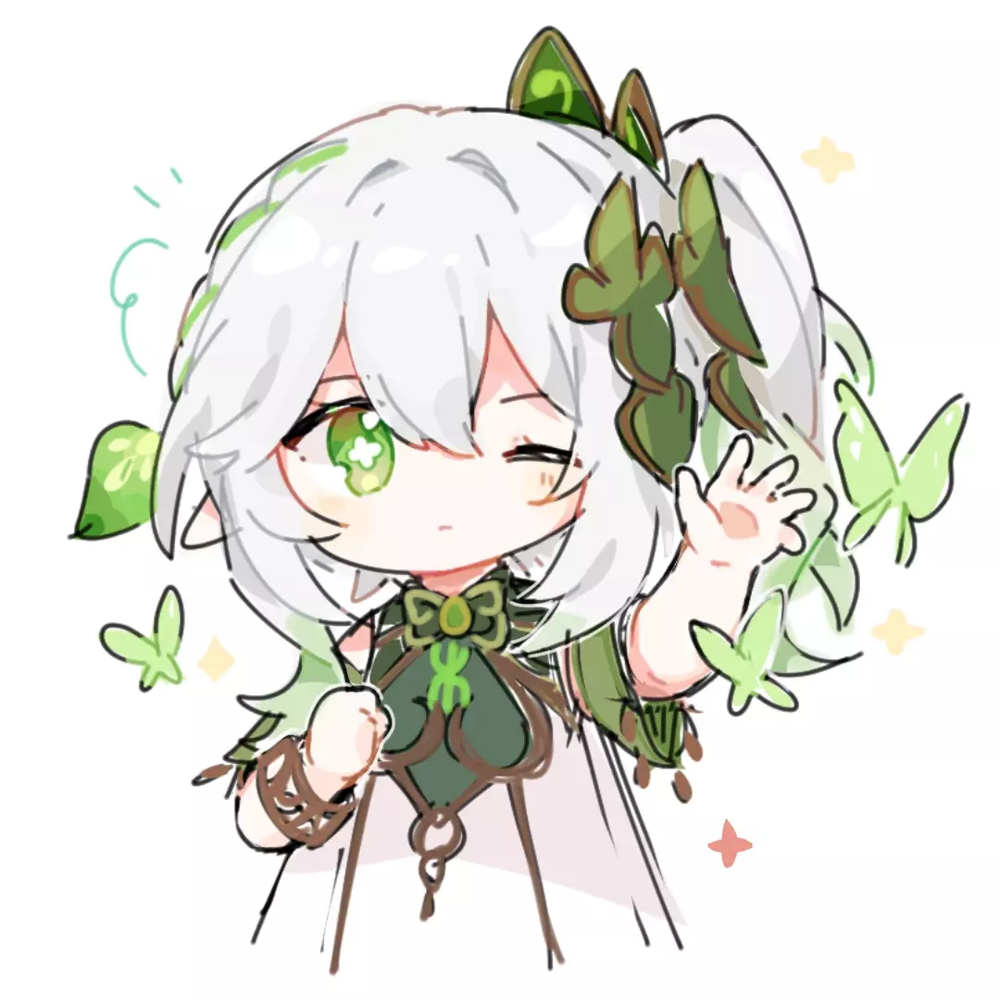

### Hi there 👋

这里是 Yumeka，也可以叫我梦花，之前叫 KlxPiao。

~~miniyu157 是远古名字，第一次玩迷你世界的时候起的 id。~~

喜欢 golang python bash rust c# c++ kotlin ... 好吧其实都挺喜欢 (除了 jvav)。

我喜欢玩音游，尤其是 Phigros、Milthm 一类 ...

希望和更多人交朋友，或许我们也可以聊聊奇妙的代码仓库。

梦想是拥有 `BBn(114514)` 数量的 tokens。

> BBn: 忙碌海狸数

如果更多人喜欢我写的项目, 我会超级爆炸开心的。
